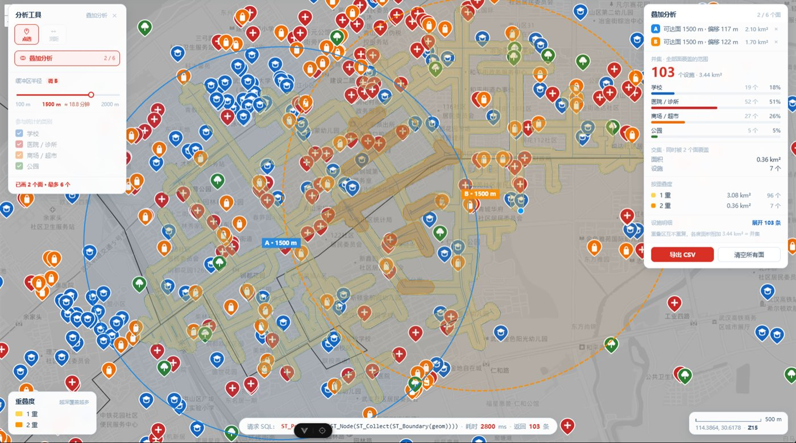

# 武汉公共服务设施可达性分析平台

把高德 POI 变成一张能回答「**走 10 分钟能到几个设施**」的地图。

一个**全链路单人项目**：从数据采集（Python）、空间入库（PostGIS）、接口服务（Spring Boot）到地图服务发布（GeoServer）与前端交互（Vue 3 + OpenLayers），四层全部自己写。

仓库：<https://github.com/Dawnivers/ServiceAvailable>


---

## 一、这个项目回答什么问题

> 「我家楼下 15 分钟走不到学校，这种地方在武汉多吗？」
> 「洪山区哪一片是医疗荒漠？」
> 「如果要在新洲补一家社区医院，选哪儿最缺？」

这类问题的共同点是：**要在一张图上同时看见全市**。所以本项目的核心不是「画点」，而是把 16,016 个 POI 压成 **39,820 个 500 m 格子的可达性数值**，再分级上色。

---

## 二、目录结构

| 目录 | 技术栈 | 职责 |
|---|---|---|
| [`etl/`](etl/) | Python 3.10 | 高德 POI 采集 → GCJ02 转 WGS84 → 入库；含完整 [采集规范](etl/spec.md) |
| [`BE/`](BE/) | Spring Boot 3.5 / JDK 17 / MyBatis | **10 个** REST 接口，空间计算**下推 PostGIS**；`db/` 放格网 SQL，`styles/` 放 GeoServer SLD |
| [`FE/`](FE/) | Vue 3.5 / OpenLayers 10.11 / Vite 8 / Pinia | 图层管理、点选详情、缓冲区分析、格网热力图；文档在 [`FE/docs/`](FE/docs/) |

```
etl/  ──→  PostgreSQL + PostGIS  ──→  GeoServer  ──→  FE/
(采集)      (Spatial 库)              (WMS 出图)      (浏览 + 分析)
                    ↑                      ↑
                    └──  BE/ (REST API)  ──┘
```

---

## 三、核心能力

### 1. 图层浏览与点选详情

GeoServer 发布 `wuhan:poi`（16,016 点）+ `wuhan:admin_area`（13 区）。
因为 `ImageWMS` 返回的是服务器画的整屏 PNG，浏览器侧**没有 Feature**，
所以点击走 `GetFeatureInfo` 拿 `gid`，再请求后端 `/api/poi/{gid}` 取详情——
**GeoServer 只回答"点是哪个"，后端只回答"这个是什么"**，职责不重叠。

悬停也走同一套探针（`map/probe.js`，单次 **12 ms**）：热力格描双色边框并报该格数量，POI 出光圈并报名称；
点击后再落一层「选中」（主色描边 + 常驻标签），**与悬停并存不互相擦**，关卡或切走自动收回。

### 2. 缓冲区分析（D13）

点选中心 → 画 800 m 圆 → 后端 `ST_DWithin` 统计 → 右侧面板出结果。

两种绘制工具：**点选 / 测距**（矩形与自由绘制已下线，原因见 §2.4.17①：
可达性的起点必须是一个点，一块地没有「从哪出发」可言）。
底部「请求 SQL」条实时显示真正执行的 PostGIS 语句、耗时与返回条数——让分析过程透明可核。

滑杆拖到哪都直接显示步行时间：**800 m ≈ 10 分钟**（80 m/分钟），
换算常量只在 `stores/analysis.js` 里写一处，滑杆 / 地图标签 / 面板共用。

### 3. 路网可达：真实步行等时圈（F6，`GET /api/poi/isochrone`）

**这是本项目最核心的一次口径升级**：把「800 m 直线圆」换成「沿路网走 800 m」。

直线圆等于假设「这片地上每一点都能直线走过去」，而武汉被长江、东湖、京广线、
封闭小区、没有过街设施的主干道切得七零八落。实测同一个 800 m 预算：
**直线圆 2.011 km² / 83 个，路网可达面 0.99–1.19 km² / 76–80 个**——
面积差 49%，少掉的那一半正是"看得见但走不到"的设施。

一条 SQL 跑完九步（吸附 → 扣掉吸附距离 → `pgr_drivingDistance` → 补半截边 →
`ST_LineMerge` 焊骨架 → 50 m 缓冲 → 面内设施），点选后地图上同时出三层：

| 图层 | 内容 |
|---|---|
| 红虚线圆 | 直线口径 800 m（对照用） |
| 蓝面 | 真实可达面（沿路网 + 50 m 缓冲） |
| 蓝线 | 可达路网骨架 |

右上两张卡并排对照：`AnalysisResult`（直线口径）与 `ReachPanel`（路网口径，
含面积、设施数、分类、路网段数/里程、**起点偏移**）。

> **起点偏移**是必须暴露的诚实数据：点击点会被吸附到最近路网节点，
> 实测 11–191 m，所以可达面以**吸附后的节点**为中心，可能与圆不同心。

3.2 s / 88 KB（gzip 后 16 KB），24 万条边的步行网，最大连通分量 95.55%。

### 4. 多边形范围统计（`/api/poi/within`）

后端吃**任意 WKT 多边形**，不止矩形：`ST_IsValid` 体检 → 面积上限校验 → `ST_Within` 统计 →

> 前端自 2026-11-04 起不再调用它（矩形/自由绘制已下线，§2.4.17①），
> 但接口本身保留：它是通用的「任意范围统计」，有测试覆盖，也能被外部调用方直接用。
返回 `count / areaKm2 / centroid / byCategory / items`。

### 5. 500 m 格网可达性热力图（D16–D18）

每格取中心点，统计 **800 m 步行圈**内的设施数（不是「格子里有几个」），
再除以「全市密度 × 圆面积」得到**相对倍数**，按 `[0.2, 1, 3, 10, 25]` 分档上色。


支持按 **全部 / 学校 / 医院 / 商场 / 公园** 切换——同一图层换 `STYLES` 参数，不重建图层。

### 6. 叠加分析（`POST /api/poi/overlay-network`）

在地图上点 **2–6 个点**，每个点先折算成「沿路网走 800 m」的真实可达面，再一次算出
**并集、交集、以及每个设施被几层覆盖**，原子面按重叠度上色，结果与设施明细都能导出 CSV。

**语义**：哪些地方**同时**处在 N 个点的 800 m 步行范围内
（例如选幼儿园：同时落在爸妈公司和家 800 m 内的片区）。

核心不是求交，而是**切面**：两两 `ST_Intersection` 会把三重区算 3 次（3 个面虚报 40%），
所以用**平面细分**——所有边界 `ST_Node` 打断 → `ST_Polygonize` 炸成互不重叠的原子面 →
每块反查自己属于哪些面。于是"按重叠度分组"变成一句 `GROUP BY`，还自带一条可验证的恒等式：
各度面积之和 = 并集面积、各度设施数之和 = 并集设施数。

> 路网口径下的实测（3 个相交圈）：并集 **1.922 km² / 150 个**，
> 1 重 1.768 km² / 141 个，2 重 0.155 km² / 9 个，**141 + 9 = 150** ✅。
> 实现上不复制那 200 行求交 SQL：Java 循环调 `isochroneGeom` 拿面，
> 再当作 `kind='area'` 喂回同一个 overlay 查询。



上图是**真实跑出来的一帧**（武汉市汉阳，半径 1500 m）：两个圈各带自己的可达面与路网，
右上角同时给出并集（103 个）、交集（0.36 km² / 7 个）与按重叠度的分档（1 重 96、2 重 7）。
底部「请求 SQL」条显示当下执行的细分语句与 **2800 ms** 耗时——面板上每个数字都能这样回溯。

---

## 四、关键实测数字

| 指标 | 值 |
|---|---|
| POI | **16,016** 条（学校 4,648 / 医院 5,347 / 商场 4,858 / 公园 1,163） |
| 格网 | **39,820** 个 500 m 方格，覆盖 8,570 km²（市域 8,574.6 km² 的 99.95%） |
| 全市基准密度 | **1.868 个/km²**（= 一个 800 m 圆内平均 3.76 个） |
| 零覆盖格 | **26,786 格（67.3%）**——800 m 内一个四类设施都没有 |
| 最密集处 | 江汉路一带 **46.9 倍**全市平均（商场密度更是全市第一） |
| 区级差异 | 江汉 38.97 /km² ↔ 黄陂 0.60 /km²，**相差 65 倍** |
| 叠加（3 个相交圆） | 原子面 **7 块**；并集 4.087 km² / 165 个，交集 0.968 km² / 54 个 |
| **步行网** | **241,611 条边 / 183,396 个节点 / 52,225 km**，最大连通分量 **95.55%** |
| **等时圈（800 m，武大）** | 吸附 11 m / 实用 789 m / **1.168 km²** / 79 个 / 2,951 段+130 半截 / 35.73 km 路 / **3.2 s** |
| **直线 vs 路网** | 同一预算：圆 2.011 km² / 83 个 ↔ 可达面 1.168 km² / 79 个（**面积 −42%**） |
| **叠加（路网口径，3 圈）** | 2.6 s / 51 KB；并集 1.922 km² / 150 个；1 重 141 / 2 重 9（**闭合**） |
| 响应体积 | 等时圈 88 KB → **gzip 16 KB**（4.6:1，已开 `server.compression`） |
| 悬停探针 | `GetFeatureInfo` 单次 **12 ms**（90 ms / 5 px / 结果去重 / inFlight 四道锁） |
| 接口 / 测试 | **10 个接口**，`mvn test` **6 用例**全绿 |

---

## 五、快速开始

### 依赖

PostgreSQL 18 + PostGIS 3.6（库名 `Spatial`）、JDK 17、Maven、Node 20+、GeoServer 2.28

### 1. 数据与空间库

```bash
cd etl
cp .env.example .env          # 填高德 key 与数据库密码
pip install -r requirements.txt
python main.py --replay       # 或直接采集：python main.py
```

### 2. 后端

```bash
cd BE
# 建表 + 生成格网 + 算统计（见 BE/db/README.md，约 15 分钟）
psql -f db/01_ddl_grid_500m.sql
psql -f db/02_build_grid_500m.sql
psql -f db/03_refresh_grid_500m.sql

mvn spring-boot:run           # http://localhost:8094
```

### 3. GeoServer

端口 8080，工作区 `wuhan`，发布 `poi` / `admin_area` / `grid_500m` 三个图层。
样式源文件在 [`BE/styles/`](BE/styles/)，发布脚本见该目录 README。

### 4. 前端

```bash
cd FE
cp .env.example .env          # 填天地图 tk（矢量 + 影像四路）
npm install
npm run dev                   # http://localhost:5173
```

---

## 六、几个值得展开的设计取舍

完整的推导、实测数据与踩坑记录都在 [`FE/docs/roadmap.md`](FE/docs/roadmap.md)，这里只列最关键的几条：

| 决策 | 为什么 |
|---|---|
| **统计用 800 m 圆，不是格内** | 可达性问的是「我能走到什么」。只数格内会把「隔壁 50 米有医院」判成医疗荒漠 |
| **500 m 格 + 800 m 圆，故意不相等** | 格子决定「看得多细」，半径决定「说得对不对」。若强求内切圆 → 半径退到 250 m = 步行 3 分钟，那个尺度下处处达标，图没有区分度 |
| **颜色用相对倍数，弹窗用绝对数量** | 四类量级差 9 倍（max 13 vs 116），绝对数量要四套图例；倍数一套通吃，且图例不随数据更新失效 |
| **公园单独按「个数」分档** | 公园仅 1,163 条，1 个就等于全市平均 3.67 倍，按倍数会出现两个空档（实测 0 个格子） |
| **格网预计算 + 增量刷新** | 实时算要 6.4 亿次球面距离（单请求几十秒）。物化成表后，新增 POI 只重算受影响的约 10 格——**788 ms** vs 全量 15 分钟 |
| **叠加用平面细分，不两两求交** | 两两求交会把三重区算 3 次（3 面虚报 40%）。细分出的原子面互不重叠，"按重叠度分组"退化成一句 `GROUP BY`，还自带「各度之和 = 并集」这个可验证的恒等式 |
| **不画零覆盖格** | 67.3% 的格子是 0，画成灰块会让底图完全被糊住 |

---

## 七、数据边界（必须说清楚）

13 个区的 POI 数几乎全在 **1,100–2,000** 之间，而面积比最高达 **79 倍**（江汉 28.5 km² vs 黄陂 2,247 km²）。

→ **说明采集是按「每区抓 N 条」做的，不是按真实密度。**

所以这张热力图本质是「**高德 POI 采集分布图**」，不是「公共服务设施真实分布图」。
它反映的是「数据覆盖的空间格局」，判断具体片区的设施有无时需要回到原始数据核验。

另外：`rating` 字段只有 **45%** 有值、`open_time` **58%**，详情卡按空值降级显示。

---

## 八、文档索引

| 文档 | 内容 |
|---|---|
| [`FE/docs/roadmap.md`](FE/docs/roadmap.md) | 开发路线、设计决策、实测基线、全部踩坑记录（2630 行） |
| [`BE/db/README.md`](BE/db/README.md) | 格网表结构、全量/增量刷新、数据口径 |
| [`BE/styles/README.md`](BE/styles/README.md) | SLD 清单、发布命令、三个渲染坑 |
| [`etl/spec.md`](etl/spec.md) | 采集规范：接口、字段、坐标转换、去重规则 |

---

## 九、许可

学习与求职用途。数据来源高德开放平台，遵守其服务条款。
