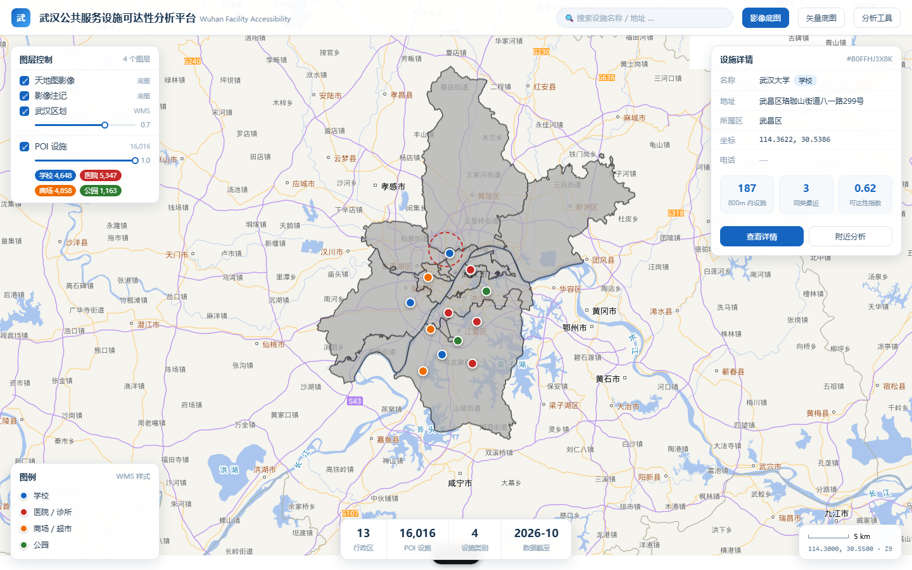
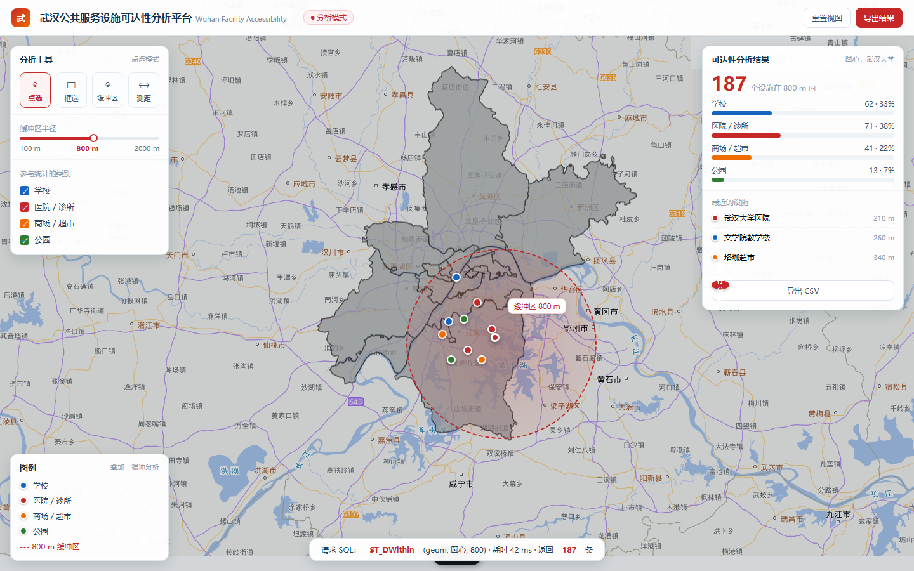

# FE 功能路线与组件清单

> 面向 `FE`（Vue 3 + Vite + OpenLayers）的开发清单。
> 数据侧（采集/入库）见 `etl/spec.md`；服务侧（发布/样式）见本文 §7。
> 最后更新：2026-10-25

## 0. 项目形态（两张图定方向）

**浏览态**——日常查看、演示开场：



**分析态**——D13 之后的主战场（点选 → 缓冲区 → 统计）：



> 两张是**设计稿**（用真实底图 + UI 叠加做的），不是最终界面；实现时可以改配色/布局，但组件边界按本文走。

---

## 1. 功能路线图

| 阶段 | 功能 | 交付物 | 依赖 |
|---|---|---|---|
| **D5–D6** | 后端起项目 + 第一个查询接口 | `/api/hello`、`/api/areas`（13 区 GeoJSON） | Maven / JDK17 / PostGIS |
| **D8–D9** | 三个业务接口 | `/api/poi/{gid}`、`/api/poi/nearby`、`/api/stats` | D6 的 MyBatis |
| **D10–D11** | 测试 | `mvn test` 绿（3 用例） | D9 |
| **D12** | 地图交互 | 图层开关 + 透明度 + 点击弹详情 | GeoServer `wuhan:poi` ✅ |
| **D13–D15** | 缓冲区分析 | 点选 → 800 m 圆 → 统计卡片 | D9 的 `nearby` 接口 |
| **D16–D18** | 格网 + 热力图 | `grid_500m` 表 + GeoServer 新图层 + 前端分级 | PostGIS 空间函数 |
| **D19–D20** | 打磨 + 录屏 + README | 30 秒演示视频、五张截图 | 以上全部 |
| **D21** | 复盘 + 投递 | 简历 + 项目自述 | — |

---

## 2. 组件清单（按阶段分批，别一次性全写）

### 2.1 现在（D12 前）——只做 5 个

| 类型 | 文件 | 职责 | 行数量级 |
|---|---|---|---|
| Pinia store | `src/stores/layers.js` | `visible` / `opacity`（**只存布尔与数字**） | 30 |
| 配置 | `src/map/wms.js` | `createAdminLayer()` / `createPoiLayer()` | 30 |
| 配置 | `src/map/layers.js` | 图层注册表（数据驱动，面板从它生成） | 20 |
| 组件 | `src/components/LayerPanel.vue` | 勾选 + 透明度滑杆 + 类别 chips | 40 |
| composable | `src/composables/useLayerSync.js` | `watch(store)` → `layer.setVisible/setOpacity` | 20 |

### 2.2 D12 加 3 个

| 文件 | 职责 |
|---|---|
| `src/components/PoiDetailCard.vue` | 右侧详情卡（固定骨架 + 空值降级） |
| `src/composables/useFeatureInfo.js` | `map.on('singleclick')` → `getFeatureInfoUrl` → `fetch` |
| `src/stores/selection.js` | `selected { gid, name, category, … }`（**存 id 与属性，不存 Feature**） |

### 2.3 D13 之后

| 文件 | 职责 |
|---|---|
| `src/components/AnalysisToolbar.vue` | 点选/框选/缓冲区/测距 + 半径 + 类别勾选 |
| `src/components/AnalysisResult.vue` | 覆盖数、分类占比、最近设施列表 |
| `src/composables/useBufferAnalysis.js` | 调 `/api/poi/nearby` + 前端画圆 |
| `src/stores/analysis.js` | `activeTool`、`radius`、`center`、`result` |

### 2.4 可以一直不做的（先不做）

| 组件 | 替代方案 |
|---|---|
| `SearchBox.vue` | 用 WFS 的 `CQL_FILTER` 或直接调后端 |
| `Toast.vue` / `LoadingOverlay.vue` | 先用 `console` / OL 自带的 fade |
| `BaseMapSwitch.vue` | 先写死影像底图，D19 再补 |

---

## 3. 目录结构（目标态）

```
src/
├── main.js                 createApp + pinia（router 目前是死配置，可删）
├── App.vue                 全屏容器 + <MapView/> + 面板
├── styles/
│   ├── main.css            reset + 高度链（html/body/#app 100%）
│   └── panels.css          面板皮肤
├── map/
│   ├── useMap.js           建图/销毁（onMounted / onBeforeUnmount）
│   ├── wms.js              ImageWMS 工厂（admin / poi）
│   ├── layers.js           图层注册表
│   └── basemaps.js         天地图 URL 工厂（tk 从 .env 读）
├── components/
│   ├── LayerPanel.vue
│   ├── PoiDetailCard.vue
│   ├── AnalysisToolbar.vue   (D13)
│   ├── AnalysisResult.vue    (D13)
│   └── LegendPanel.vue       (D19)
├── composables/
│   ├── useLayerSync.js
│   ├── useFeatureInfo.js     (D12)
│   └── useBufferAnalysis.js  (D13)
└── stores/
    ├── layers.js
    ├── selection.js          (D12)
    └── analysis.js           (D13)
```

---

## 4. WMS 图层参数（已验证可用）

`poi` 图层：

```js
{
  url: '/geoserver/wuhan/wms',        // 走 Vite proxy，避开 CORS
  params: {
    LAYERS: 'wuhan:poi',
    STYLES: 'wuhan:poi_icons',         // ★ 必须带工作空间前缀
    VERSION: '1.1.1',
    FORMAT: 'image/png',
    TRANSPARENT: true,                 // ★ 不加会盖住底图
  },
  serverType: 'geoserver',
  ratio: 1.5,
}
```

`admin_area` 图层：同上，`LAYERS: 'wuhan:admin_area'`、`STYLES: ''`、`opacity: 0.7`。

**图层顺序**：底图影像 → 影像注记 → 区划 → POI（最后 `addLayer` 的在上层）。

---

## 5. 后端接口契约（全 6 个已实现，2026-10-29）

> 原则：**键永远存在，缺值给 `null`**；不透传高德原始 JSON。

### 5.0 接口总览（D12 前端按此开发）

| # | 接口 | 状态 | 参数 | 实测基线 |
|---|---|---|---|---|
| 1 | `GET /api/hello` | ✅ D5 | — | `{"message":"BE is up",...}` |
| 2 | `GET /api/ping-db` | ✅ D5 | — | `13` |
| 3 | `GET /api/areas` | ✅ D5 | — | 85166 bytes / 13 features |
| 4 | `GET /api/poi/{gid}` | ✅ D7 | path `gid` | `/api/poi/1` → 解放公园 / 3 张照片 |
| 5 | `GET /api/poi/nearby` | ✅ D8 | `lon` `lat` [radius=800] [limit=5] | 114.36,30.54,800 → count 124 |
| 6 | `GET /api/stats/coverage` | ✅ D9 | `adcode` | 420106 → total 1681 / perKm2 16.8 |

**约定**：JSON 字段**全驼峰**（`amapId` / `radiusM` / `byCategory` / `areaKm2`）；`photos` 恒为数组（无照片时 `[]`）；HTTP 错误统一 `{timestamp,status,error,path}`。

### 5.1 已实现（D5）

```jsonc
// GET /api/areas  —— 武汉 13 区边界（GeoJSON FeatureCollection, WGS84）
// 实测：HTTP 200 / 85166 bytes / ≈0.01s / 13 features
{
  "type": "FeatureCollection",
  "features": [
    {
      "type": "Feature",
      "properties": {
        "adcode": 420107,             // integer，行政区码
        "name": "青山区",
        "level": "district",
        "center": [114.3915169, 30.6364754]   // [lon, lat]，float8[]
      },
      "geometry": {                   // ★ 是对象，不是字符串（SQL 里 ST_AsGeoJSON(geom)::json）
        "type": "MultiPolygon",
        "coordinates": [/* 环 → 点 → [lon, lat] */]
      }
    }
  ]
}
```

- 返回类型：`JsonNode`（结构由 SQL 决定、geometry 多态，不适合 DTO）
- 前端消费（D12）：
  ```js
  const data = await (await fetch('/api/areas')).json();
  new GeoJSON().readFeatures(data, {
    dataProjection: 'EPSG:4326',     // 后端是 WGS84 经纬度
    featureProjection: 'EPSG:3857',  // View 是 3857，交给 OL 转换
  });
  ```
- 另有两个探针接口：`/api/hello`（Web 层）、`/api/ping-db`（返回 `13`，证数据库链路）

### 5.2 已实现（D8，2026-10-28）

```jsonc
// GET /api/poi/{gid}  —— 实测 gid=1 原样输出
{
  "gid": 1,                        // bigint → Java Long（用包装类，不是 long）
  "amapId": "B001B0IZT0",          // ★ 键是驼峰 amapId，不是 amap_id（Jackson 序列化 record 字段名）
  "name": "解放公园",
  "category": "park",              // school | hospital | mall | park（库内实测就这 4 类）
  "typecode": "110101",
  "address": "解放大道1861号",       // 100/16016 为 null
  "tel": "027-82421760",           // 7242/16016 (45%) 为 null，null 时原样输出 null
  "lon": 114.292598,               // 取自 ST_X(geom)
  "lat": 30.610841,                // 取自 ST_Y(geom)
  "photos": [                      // ★ 是 JSON 数组（不是字符串），恒存在，无照片时是 []
    "http://store.is.autonavi.com/showpic/26df2710...",
    "http://store.is.autonavi.com/showpic/ec9d8ab5...",
    "http://store.is.autonavi.com/showpic/342d282b..."
  ],
  "detailFetched": false           // ★ 驼峰；由 detail_fetched_at is not null 算；当前恒为 false
}
```

**状态码**（已实测）：

| 请求 | 返回 |
|---|---|
| `/api/poi/1` | `200` + 上述对象 |
| `/api/poi/39`（无照片） | `200`，`photos: []` |
| `/api/poi/999999999`（不存在） | `404`，`throw ResponseStatusException(NOT_FOUND)` |
| `/api/poi/abc`（非数字） | `400`，Spring 自动转换失败，服务端只打 WARN |

**实现要点（踩过的坑，D9 写 nearby/stats 时复用）**：

1. **坐标统一用 `ST_X(geom)` / `ST_Y(geom)`** —— 实测 `lon/lat` 两列与 geom **完全一致**（全表 `max_diff_m = 0`、`rows_over_1m = 0`），但 geom 是 ETL 转 WGS84 后的权威源，`lon/lat` 是冗余副本。
2. **`photos` 只取 url**：SQL 用 `jsonb_path_query_array(raw, '$.photos[*].url')::text as photos`。
   原 `raw->'photos'` 是**对象数组**（`{"url":..., "title":..., "provider":[]}`），其中 `title` 有 99.87%（35953/36000）是空数组 `[]`、仅 0.13%（47 条）是字符串（"春季"/"秋季"等），**类型不一致** —— 为 0.13% 保留 title 不值得，故只提 url。若要 title，改用 `List<Map<String,Object>>`。
3. **`photos` 需要自定义 TypeHandler**：`config/StringListTypeHandler`（jsonb 文本 → `List<String>`，空值归一成 `[]`）。MyBatis 内置没有 jsonb→List 的转换器，不写就报 `argument type mismatch`。
4. **`PoiDto` 用 record + `<constructor>` resultMap**；**DTO 字段用包装类（`Long`/`Double`/`Boolean`）而非基本类型** —— MyBatis 内部装箱成包装类，用基本类型会报 `NoSuchMethodException`。
5. **`adname`、`biz_ext` 未实现** —— `poi` 表无 `adname` 列（需 JOIN `admin_area` 才有）；`biz_ext` 需另取 `raw->'biz_ext'`。两者都留到 D12 详情卡再补。

### 5.3 已实现（D9，2026-10-28）

```jsonc
// GET /api/poi/nearby?lon=114.36&lat=30.54&radius=800&limit=5  —— 实测原样输出
// 圆心 114.36,30.54（武大一带）半径 800 m
{
  "count": 124,
  "center": { "lon": 114.36, "lat": 30.54 },
  "radiusM": 800.0,                    // ★ 驼峰 radiusM（不是 radius_m）
  "byCategory": {                      // ★ 驼峰；四类键恒存在，缺的补 0
    "school": 109, "hospital": 2, "mall": 10, "park": 3
  },
  "nearest": [                         // 按 distanceM, gid 排序（并列时按 gid 稳定）
    { "name": "武汉大学-教1楼",             "category": "school", "distanceM": 53.0 },
    { "name": "教育部武汉大学文科文献信息中心", "category": "school", "distanceM": 62.0 },
    { "name": "武汉大学国内合作部",          "category": "school", "distanceM": 62.0 },
    { "name": "武汉大学招生就业处组织部",     "category": "school", "distanceM": 67.0 },
    { "name": "武汉大学-审计处",            "category": "school", "distanceM": 77.0 }
  ]
}
```

**参数**：

| 参数 | 必填 | 默认 | 校验 |
|---|---|---|---|
| `lon` | ✅ | — | **目前未校验**（技术债，见下） |
| `lat` | ✅ | — | **目前未校验** |
| `radius` | ❌ | `800` | `(0, 5000]`，越界 400 |
| `limit` | ❌ | `5` | `(0, 50]`，越界 400 |

**状态码**（已实测）：

| 请求 | 返回 |
|---|---|
| `?lon=114.36&lat=30.54&radius=800` | `200`，`count: 124` |
| `?lon=114.40&lat=30.56&radius=800`（东湖水域） | `200`，`count: 0`、`byCategory` 四类全 0、`nearest: []` |
| 只传 `lon/lat` | `200`，`radiusM: 800.0`（默认值生效） |
| `radius=-5` | `400` |
| 缺 `lon` | `400` |

**实现要点**：

1. **`count` 由 `byCategory` 求和，不单独查 `count(*)`** —— 保证 `count == ΣbyCategory`，前端做饼图分子分母天然一致；并发写入时也不会出现两者不等。
2. **`byCategory` 先铺四类为 0，再用实际结果覆盖**（`LinkedHashMap` 保持固定顺序）—— 不需要判断"缺了哪个"，新增类目也能自动带出。
3. **`order by "distanceM", gid`** —— 加 `gid` 保证距离并列时顺序稳定，否则 D10 的测试会偶发失败。
4. **SQL 别名 `as "distanceM"` 必须带双引号** —— PG 会把不加引号的标识符转小写（`distancem`），`resultType` 就取不到列；`order by` 里同理。
5. **`limit #{limit}` 在 PG 驱动下可用**（`limit $1`），不需要改成 `${limit}`。

**nearby 技术债（D11 补）**：`lon`/`lat` 未做范围校验，传 `lon=999&lat=888` 会返回 `count: 0` 而不是 400。

### 5.4 已实现（D10，2026-10-29）

```jsonc
// GET /api/stats/coverage?adcode=420106  —— 实测原样输出（武昌区）
// ★ 参数是 adcode（integer），不是 district！中文参数在 PowerShell 下会撞编码坑
{
  "adcode": 420106,
  "district": "武昌区",
  "total": 1681,
  "areaKm2": 100.06,               // DataV 边界是陆域轮廓，不是含水域的行政面积
  "perKm2": 16.8,                  // Java 里用 BigDecimal 算：1681 / 100.06，保留 2 位
  "byCategory": { "school": 525, "hospital": 590, "mall": 447, "park": 119 }
}
```

**状态码**（已实测）：

| 请求 | 返回 |
|---|---|
| `?adcode=420106` | `200` + 上述对象 |
| `?adcode=999999`（不存在） | `404`（`statByAdcode` 返回 null → `ResponseStatusException`） |
| `?adcode=abc`（非数字） | `400`（Spring 类型转换拦截） |

**实现要点**：

1. **参数用 `adcode` 而非区名** —— 无编码问题、天然唯一；前端从 `/api/areas` 的 feature.properties 就能拿到每个区的 `adcode`。
2. **JOIN 必须 `p.adcode = a.adcode::text`** —— `poi.adcode` 是 text，`admin_area.adcode` 是 integer。
3. **`total` 用 `count(p.gid)` 而不是 `count(*)`** —— 语义一致（`left join` 空匹配时 null 不计数）。分类四项用 `count(*) filter (...)` 在当前数据下结果相同（`null = 'school'` 为 NULL 不计数），为一致性建议统一写 `count(p.gid)`。
4. **`perKm2` 在 Java 算，不在 SQL 算** —— `BigDecimal.divide(x, 2, HALF_UP)`；PG 的 `round(double, int)` 不存在（需 `::numeric`），而且放 Java 更可测。
5. **`areaKm2 <= 0` 要做除零保护** —— Java 的 `double / 0` 返回 `Infinity`，Jackson 序列化成 `null`，前端会静默拿到 null。

> 旧稿写 `total: 1782` / `area_km2: 305.6` / `per_km2: 5.83`，是把“含水域行政面积”当成了边界面积。若将来想用行政面积口径，需另存一份面积字段，不要用 `ST_Area(geom)`。
> 13 区 POI 实测分布：洪山1940 / 武昌1681 / 江夏1634 / 江岸1382 / 黄陂1352 / 蔡甸1336 / 汉阳1244 / 东西湖1213 / 硚口1178 / 新洲1170 / 江汉1104 / 青山582 / 汉南200。

**错误约定**：HTTP 400 参数缺失、404 资源不存在、500 内部错误；body 统一 `{ "code": 400, "message": "…" }`。

---

## 6. 状态设计纪律（今天踩过的坑）

| 规则 | 原因 |
|---|---|
| **OL 实例绝不进 Pinia / reactive** | Proxy 会破坏图层/要素身份，表现为"图层不显示""setOpacity 无效" |
| 地图实例用模块级单例或 `shallowRef(markRaw(...))` | 同上 |
| 建图只在 `onMounted` 里 | `setup` 阶段 DOM 还没插入，`getElementById` 为 null，OL **静默跳过** |
| `html, body, #app` 全部 `height: 100%` | 少一环 → `#map` 高度 0 → 连 WMS 请求都不发 |
| `watch` 加 `immediate: true` | 否则初始状态不同步 |
| store 里只放 `visible/opacity/selectedId` 这类**值** | 地图动作由 `useLayerSync` 单向翻译 |

---

## 7. 服务侧依赖（GeoServer）

| 资源 | 名称 | 说明 |
|---|---|---|
| 图层 | `wuhan:admin_area` | 13 区边界 |
| 图层 | `wuhan:poi` | 16,016 条 POI（数据类型 Point,4326） |
| 样式 | `wuhan:poi_icons` | SVG 图钉 + 标签 + 两级缩放（**推荐**） |
| 样式 | `wuhan:poi_badge` | 纯矢量徽章（无外部依赖，兜底用） |
| 样式 | `wuhan:poi_by_category` | 简单四色圆点（对照用） |

> 图钉依赖 URL Checks 放行 `http://localhost:8080/geoserver/www/.*`（配置文件 `data_dir/security/urlchecks.xml`）。
> 新建样式后记得 `POST /rest/reload`。

---

## 8. 里程碑验收

| 里程碑 | 判据 |
|---|---|
| **D5–D6 完成** ✅ | 后端 8094 起；`/api/areas` → 85166 bytes / 13 features；四层拆分（controller/service/mapper）完成，重构前后哈希一致 |
| **D7–D8 完成** ✅ | `/api/poi/{gid}` → 200 + `photos` 数组 + 404/400 边界；`/api/poi/nearby` → count 124 / 四类齐全 / 0 条时返回空结构 |
| **D9 完成** ✅ | `/api/stats/coverage?adcode=420106` → total 1681 / areaKm2 100.06 / perKm2 16.8 |
| **D10–D11 完成** | `mvn test` 3 用例绿（覆盖三个业务接口的主路径） |
| **D12 完成** | ① 页面上能看到 POI（放大出图钉）② 关闭勾选立即消失 ③ 透明度滑杆生效 ④ Network 里 `STYLES=wuhan:poi_icons` 且 200 ⑤ 拖动不卡成幻灯片 |
| **D13 完成** | 点地图 → 画出 800 m 圆 → 右侧数字与 `ST_DWithin` 查询结果一致 |
| **D18 完成** | 500 m 格网分级渲染（覆盖率热力）+ 图例可读 |
| **D20 完成** | 30 秒录屏；README 含架构图、启动步骤、5 张截图、踩坑记录 |

---

## 9. 性能备忘

| 场景 | 现状 | 升级触发条件 |
|---|---|---|
| 每次拖动重绘一张整屏 WMS | `ImageWMS`，约 80–150 KB/次 | 明显卡 → 换 `TileWMS` + GWC 缓存 |
| 全市 16k 点在低缩放渲染 | 样式已用 `MinScaleDenominator` 收成 3 px 小点 | 仍慢 → GeoServer 侧聚合 / MVT |
| 高缩放查看细节 | 图钉 36 px + 标签 | 标签重叠 → `VendorOption conflictResolution`（已开） |

---

## 10. 数据库索引与迁移（D6 补，2026-10-27）

> 建索引和 `ANALYZE` 都不进 git，**换台机器部署时必须手动执行本节**。执行顺序即下方顺序。

### 10.1 空间索引（必需）

`poi` 原本只有 4 个 btree 索引（`gid` / `amap_id` / `category` / `adcode`），**没有任何空间索引**，
`ST_DWithin` 查询走全表扫。2026-10-27 已补：

```sql
-- ★ 必须是"表达式索引"：查询里筛的是 geom::geography，索引也要建在同一个表达式上
--   写成 GIST (geom) 用不上（PG 认为 geom ≠ geom::geography）
--   双括号 ((...)) 是 PG 建表达式索引的语法，少一层会报语法错
CREATE INDEX idx_poi_geog ON poi USING GIST ((geom::geography));

ANALYZE poi;   -- 大批量导入后必做，否则优化器用旧的行数分布
```

**实测收益**（`poi` 表 16016 行，圆心 `114.36, 30.54`，半径 800 m，`order by "distanceM", gid limit 5`）：

| 指标 | 建索引前 | 建索引后 |
|---|---|---|
| 执行计划 | `Parallel Seq Scan` | `Bitmap Index Scan on idx_poi_geog` |
| 执行时间 | 88.4 ms | **23.9 ms** |
| 读数据页 `Buffers` | 4758 | **200** |
| 规划成本 `cost` | 88388 | 1629 |

> 注意：早先误建的 `idx_poi_geom_gist ON poi USING GIST (geom)` **用不上**，已删除。
> 规则：凡 `where` 里对列做了函数/类型转换（`::`、`lower()`、`ST_Transform()`），想走索引就必须建**表达式索引**。

### 10.2 nearby 查询的标准写法（D8/D13 照此实现）

```sql
-- 分类计数：ST_DWithin 筛范围，::geography 决定单位是"米"
select category, count(*) as cnt
from poi
where ST_DWithin(
        geom::geography,
        ST_SetSRID(ST_MakePoint(114.36, 30.54), 4326)::geography,
        800)
group by category
order by cnt desc;

-- 最近 N 个：ST_DWithin 粗筛 + ST_Distance 精算（别在 where 里用 ST_Distance，会逐行精算）
-- ★ 别名写 "distanceM"（双引号保留大小写，对应 Java 的 distanceM 字段）
select name, category,
       round(ST_Distance(geom::geography,
             ST_SetSRID(ST_MakePoint(114.36, 30.54), 4326)::geography)) as "distanceM"
from poi
where ST_DWithin(geom::geography,
        ST_SetSRID(ST_MakePoint(114.36, 30.54), 4326)::geography, 800)
order by "distanceM", gid          -- ★ 加 gid：距离并列时结果才稳定（否则测试会偶发失败）
limit 5;
```

**三个必守的细节**：
- 漏 `::geography` → 单位变成"度"，`800` 会匹配全表且不报错（静默错）
- `ST_MakePoint(lon, lat)` 参数顺序是**经度在前**，写反得到南极附近的点，返回空但不报错
- `ST_MakePoint` 出来 SRID=0，必须 `ST_SetSRID(..., 4326)` 否则报 `mixed SRID geometries`

### 10.3 其他索引

| 索引 | 用途 |
|---|---|
| `poi_pkey1 (gid)` | 主键，`/api/poi/{gid}` 已可用 |
| `idx_poi_adcode (adcode)` | `/api/stats/coverage` 按区筛（`p.adcode = a.adcode::text`） |
| `idx_poi_category (category)` | 分类筛选（D12 图层类别 chips 若下沉到 BE 则用到） |

### 10.4 改表结构/导数据后

```sql
ANALYZE poi;        -- 补统计，不影响业务读写
```
`autovacuum` 会在改动量达阈值时自动跑 `ANALYZE`，手动执行只针对「一次性大批量导入」和「调试执行计划」两个场景。
